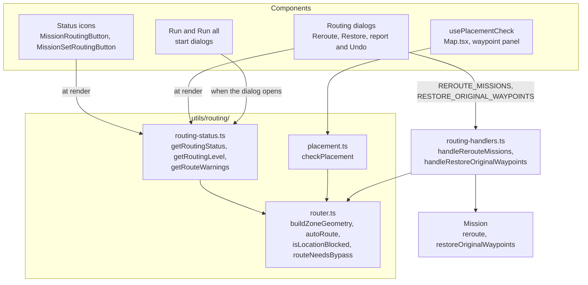

# Obstacle Avoidance in the JCC

Operators draw **exclusion zones** on the map: areas a bot must not enter. The JCC shows which
missions cross a zone and, when the operator asks, reroutes them around the zones before they are
sent. Bots know nothing about zones; they run exactly the MissionPlan they are sent.

This page covers what the feature does, how the code is arranged, and the rules that are easy to
break when changing it. It assumes the action, dispatch, handler and context model described in
[Developing with React Context](page111_developing_with_react_context.md).

## 1. What it does

Each zone has a fixed **safety margin** of 5 m, drawn on the map as a dashed orange outline
around the zone. A point inside the margin counts as inside the zone, except where section 7 says
otherwise.

- **Editing never reroutes.** Adding, moving or deleting waypoints, and drawing, editing or
  loading zones, never run the router or add detours, and no dialog opens. Deleting the last
  waypoint also removes the detours that led to it.
- **Status is shown, not stored.** Each mission header has a routing-status icon: red when the
  route crosses a zone, amber when suppressed waypoints are clear again so a reroute would bring
  them back, white otherwise. The "Mission Set" title has one for the whole set. On the map, a
  waypoint inside a zone is drawn red, unless its mission is being edited (gold) or it is a
  running bot's target. All of it is recomputed from the missions and zones as they are now.
- **The status icons are buttons.** Unlike most status indicators in the JCC, each icon is
  styled as a button and tapping it opens a routing dialog: a mission's icon opens that
  mission's dialog, and the set's icon opens the dialog for the whole set. These dialogs are the
  only way into Reroute and Restore; there are no separate Reroute or Restore buttons. Every
  mission shows its icon, even when the route is clear, and it is disabled while the mission has
  no waypoints.
- **Reroute is an explicit action**, from a mission's routing dialog, or from the set's dialog
  for every mission. It starts from the operator's original waypoints, suppresses the ones
  inside a zone and adds detour waypoints around the zones. **Restore original waypoints**
  removes the detours and brings the suppressed waypoints back. Each action is one undo entry,
  even for the whole set, and the dialog reports what it did, with its own Undo.
- **Placing a point inside a zone asks first.** Adding or moving a waypoint, a rally point or a
  survey corner inside a zone asks the operator to confirm; Cancel dispatches nothing. Appending
  past the waypoint limit is refused.
- **Run and Run all warn, and never block,** when a route crosses a zone, when the bot's straight
  path to its first waypoint crosses one, or when the bot is inside one.

## 2. Design principles

These decisions shape the code. They are deliberate; changing one is a design change, not a fix.

**Waypoints change only through an operator action:** a direct edit, a reroute, or restoring the
original waypoints. A zone edit never adds, moves, deletes or flags a waypoint, and no edit opens
an avoidance dialog, apart from the confirmation when a point is placed inside a zone.

**Only `Mission` sets the flags and markers, and only `Mission` changes its waypoint list.**
Accessors return `readonly Waypoint[]`, and `Waypoint` has no setters, so the compiler enforces
this. `addWaypoints` copies only location and task, so flags on a waypoint built elsewhere never
reach a mission.

**Reroute always starts from the original waypoints.** That is what makes an operator's edit
survive the next reroute, and what drops detours that are no longer needed. Reroute is always
available for that reason: status cannot tell when a detour has become unnecessary without
running the router.

**Status is derived, never stored.** Whether a mission crosses a zone depends on the zones as
they are now, so there is nothing stable to persist. The same goes for blocked waypoints, which
are worked out when the mission layer draws.

**Each reroute or restore is one tracked action and one undo entry,** even for the whole set.

**The reroute report is screen state.** `rerouteReport` in `JaiaContextType` is kept out of undo
snapshots, and Undo clears it. A dialog shows it only after its own action, so a reopened dialog
never shows an old report.

**The dialogs' Undo keeps the visible panel.** An ordinary Undo restores the panel that was open
at the previous edit. From a routing dialog that could close the panel the dialog was opened
over, so the dialog sends `CLICKED_UNDO` with `keepPanelState`.

**The operator decides what is sent.** Run sends exactly the visible waypoints. Crossing a zone
is a warning, never a refusal.

## 3. Terms

| Term                | Meaning                                                                                                                                                                                                         |
| ------------------- | --------------------------------------------------------------------------------------------------------------------------------------------------------------------------------------------------------------- |
| Blocked waypoint    | A waypoint inside a zone or its safety margin. Derived, by `isLocationBlocked`.                                                                                                                                 |
| Detour waypoint     | A waypoint a reroute added. It cannot be selected or edited. A flag on the waypoint.                                                                                                                            |
| Suppressed waypoint | A blocked waypoint a reroute took out of the path. It stays in the mission with its task, but is not drawn and not sent. A flag on the waypoint.                                                                |
| Visible waypoints   | The mission's waypoints without the suppressed ones: what the map shows and exactly what is sent.                                                                                                               |
| Original waypoints  | The waypoints without detours, with the suppressed ones included: what the operator or survey planner made. Derived, never stored as a copy. Reroute's input.                                                   |
| Waypoint number     | A waypoint's position among the visible waypoints, detours included. The one numbering everywhere: map markers, waypoint panel, dialogs and the bot's reported target waypoint. Suppressed waypoints have none. |
| Routing status      | Whether the visible route crosses a zone, how many waypoints are suppressed, and how many of those are clear again. Derived at render.                                                                          |
| Clear again         | A suppressed waypoint that is no longer blocked, because a zone moved or was deleted.                                                                                                                           |

## 4. Data model

**The flags and markers live on each waypoint, and only `Mission` sets them.**
`data/waypoints/waypoint.ts` has two types:

- `Waypoint`, the interface every caller outside `Mission` sees: location, task, `getIsDetour()`
  and `getIsSuppressed()`, and no setters. Segment and lane markers are not on it; outside code
  reads segments through `Mission.getSegments()`.
- `MissionWaypoint`, the class `Mission` holds, with the marker getters and every setter.

`Mission` keeps one array of `MissionWaypoint`s in mission order and returns read-only
`Waypoint` views of it:

| Accessor                           | Returns                                                                        |
| ---------------------------------- | ------------------------------------------------------------------------------ |
| `getWaypoints()`, `getWaypoint(n)` | Visible waypoints, by waypoint number                                          |
| `getOriginalWaypoints()`           | Original waypoints                                                             |
| `getSuppressedWaypoints()`         | Suppressed waypoints                                                           |
| `getWaypointNum(waypoint)`         | A waypoint's current number, or `undefined` if it is suppressed                |
| `isRerouted()`                     | Whether the mission has detours or suppressed waypoints (what Restore acts on) |

Every change to the waypoint list, the flags or the markers goes through a named `Mission`
operation, such as `addWaypoint`, `addWaypoints`, `moveWaypoint`, `deleteWaypoint`,
`setWaypointTask`, `setLaneStart`, `revertWaypoint` and `appendWaypointsFrom`. A task's settings
are edited on the `Task` object the waypoint returns. The two operations that belong to this
feature:

- `reroute(steps)` takes one router step per original waypoint (suppress it or not, and the
  detours after it). It drops the old detours, sets the suppressed flags and inserts the new
  detours, and returns counts of what changed. It leaves the mission unchanged if the result
  would exceed the waypoint limit.
- `restoreOriginalWaypoints()` drops every detour and clears every suppressed flag.

**Segments are markers, not indices.** The first segment's settings (speed, SRP) live on
`Mission`; each later segment's sit on the waypoint that starts it, and lane starts are a flag
on the waypoint. Markers never go on detours. Deleting a waypoint that carries a marker moves the
marker to the next original waypoint, or drops the segment if that one already starts a segment.

**The MissionPlan is built at send,** in one pass over the stored waypoints
(`Mission.buildPlan`), so segment indices always count the goals sent with them:

- suppressed waypoints are skipped, and a marker they carry moves to the next goal sent;
- a run of detours joins the segment and lane of the operator waypoint after it, so a segment or
  lane start opens at the first detour of the run. The bot switches segment settings on the leg
  into a segment's first goal, and the detours replace that leg;
- the result starts at goal 0, has strictly ascending segment starts, and never sends an empty
  segment.

**Saved formats.** Mission sets are version 2.2: the flags and markers are saved on each
waypoint, with no index-based segments. Older files are migrated on load by
`SNAPSHOT_MIGRATIONS` in `mission-set-storage.ts`; a version that is neither current nor in the
migration chain is refused. Zone sets are version 1.0, in files and on the hub, and an unknown
version is refused.

## 5. Code layout

Only the reroute handler runs the A\* search. Everything drawn at render uses the cheap point and
segment tests against the buffered zones.

| Where                                                                                  | What                                                                                                                                                                                                     |
| -------------------------------------------------------------------------------------- | -------------------------------------------------------------------------------------------------------------------------------------------------------------------------------------------------------- |
| `utils/routing/router.ts`                                                              | `buildZoneGeometry` projects and buffers each zone, and caches each zone's shape. `autoRoute` routes original waypoints into steps for `Mission.reroute`. Point and leg tests. The buffer the map draws. |
| `utils/routing/routing-status.ts`                                                      | `getRoutingStatus` and `getRoutingLevel` for the icons and dialogs; `getRouteWarnings` for Run.                                                                                                          |
| `utils/routing/placement.ts`                                                           | `checkPlacement`: allowed, confirm (inside a zone) or refused (waypoint limit), with the message.                                                                                                        |
| `context/handlers/routing-handlers.ts`                                                 | The two tracked actions. Each stores one `RerouteOutcome` per mission with waypoints in `rerouteReport` and keeps the waypoint selection on the same waypoint.                                           |
| `types/routing-types.ts`                                                               | `RoutingResult`, `RerouteOutcome`, `RoutingAction`.                                                                                                                                                      |
| `components/MissionsPanel/MissionStatusIcon/`                                          | The status icon that is also a button: its colour gives the level, a tap runs its handler. Reusable for other header statuses.                                                                           |
| `components/MissionsPanel/MissionsList/MissionRoutingButton/`                          | A mission's icon and dialog.                                                                                                                                                                             |
| `components/MissionsPanel/MissionSetRoutingButton/`                                    | The set's icon and dialog.                                                                                                                                                                               |
| `components/MissionsPanel/RoutingDialog/`                                              | What both dialogs share: the wording (`routing-text.ts`), the action hook with its spinner and Undo, the action button.                                                                                  |
| `components/PlacementDialog/PlacementDialog.tsx`                                       | The confirm and refuse dialog, and `usePlacementCheck`, which every placement uses.                                                                                                                      |
| `components/__buttons__/Start*Button/`                                                 | The Run warnings, computed when the start dialog opens.                                                                                                                                                  |
| `openlayers/layers/vector/mission-layer.ts`, `openlayers/features/waypoint-feature.ts` | Red blocked waypoints and numbered detours. The ghost layer is never coloured.                                                                                                                           |

## 6. Events, actions and handlers

| Operator event                                 | Action                                    | Handler                          | Undo entry           |
| ---------------------------------------------- | ----------------------------------------- | -------------------------------- | -------------------- |
| Add or move a waypoint                         | `ADD_WAYPOINT`, `MOVE_WAYPOINT`           | `waypoint-handlers.ts`           | yes                  |
| … inside a zone, cancelled                     | none: checked before dispatch             | none                             | no                   |
| Place a rally point or survey corner in a zone | as usual, once confirmed                  | as usual                         | as usual             |
| Draw, edit, delete or load zones               | the zone actions                          | `exclusion-zone-handlers.ts`     | yes                  |
| Tap a status icon, or close a routing dialog   | none: component state                     | none                             | no                   |
| Reroute, or Reroute all                        | `REROUTE_MISSIONS` with the mission IDs   | `handleRerouteMissions`          | one for all missions |
| Restore original waypoints, or Restore all     | `RESTORE_ORIGINAL_WAYPOINTS` with the IDs | `handleRestoreOriginalWaypoints` | one for all missions |
| Undo in a routing dialog's report              | `CLICKED_UNDO` with `keepPanelState`      | `handleClickedUndo`              | n/a                  |
| Run or Run all                                 | `SENT_COMMAND`, after the start dialog    | `handleSentCommand`              | no                   |

Zone edits change only the zone set; they redraw the mission layer so the red waypoints follow
the zones, and status is recomputed at render. Loading a mission set or a zone set loads it as
is: nothing is rerouted.

## 7. Invariants to keep when changing the code

Each of these is easy to break with a change that compiles and passes most tests. Each says what
goes wrong if it is ignored.

**A waypoint inside a zone needs its own test.** The leg test skips a zone when either end of
the leg is inside the zone itself (not just its margin), treating the leg as unroutable rather
than blocked. `routing-status.ts` tests the waypoints and the legs separately. _If ignored:_ a
status check built on the leg test alone shows a route as clear while one of its waypoints sits
in a zone.

**Zones are never changed in place.** Every zone edit stores a new zone object, and load and undo
build new ones. `buildZoneGeometry` caches each zone's shape in a `WeakMap` keyed by the zone
object. `ExclusionZone` is `readonly` down to its coordinates, so the compiler catches most
attempts. _If ignored:_ the zone's old shape stays in use, and placement, status, colouring and
routing all test against a zone that is no longer there.

**One projection, Web Mercator, for every zone test.** Placement, suppression, status, routing
and the drawn buffer all use the shapes `buildZoneGeometry` builds. Lengths in metres (the
margin, the A\* cell, clearances) are converted at the local latitude. _If ignored:_ a test that
projects or buffers on its own disagrees with the drawn outline near its edge, so a point can be
red on the map but placed without confirmation, or the reverse.

**Buffers are inflated, then simplified, with the margin kept.** Clipper2's decimal functions
inflate by the margin plus a tenth of it, then simplify with a tolerance of a tenth, so a buffer
is never closer to the zone than the margin (5–5.5 m for a 5 m margin). _If ignored:_ simplifying
first, or the integer functions, which round to whole metres, let corners come closer than the
margin.

**Size the search grid from the blocking zones, but test against every zone reaching into it.**
_If ignored:_ sizing it from the whole zone set makes the search area scale with the distance
between unrelated zones, up to tens of millions of cells; narrowing the collision test to the
blocking zones lets a detour pass straight through a zone it only goes near.

**A selection never outlives a renumbering.** The selected waypoint is stored by number. Reroute
and restore find its new number with `getWaypointNum`, and clear the selection, closing the
waypoint panel, only when the reroute suppressed it. _If ignored:_ a new operation that
renumbers waypoints leaves the waypoint panel editing a different waypoint.

**Status icons sit over the mission's accordion header, not inside it.** MUI renders
`AccordionSummary` as a native `<button>`, and a button cannot contain another one. The icons
are laid over the summary in `.mission-accordion-header`, which passes taps through to the
summary everywhere except on an enabled icon, so tapping a disabled icon still opens or closes
the accordion. _If ignored:_ a tap on the icon also toggles the accordion, or never reaches the
icon.

**Loading a zone set is one tracked action, and the set's name travels in its snapshot.** _If
ignored:_ undo can leave one set's name over another set's zones, and the next save overwrites
the wrong set.

## 8. Producing an unroutable route

**"No way around the zones": build a closed box out of four rectangular zones and put a waypoint
inside it.** The interior belongs to no zone, so the waypoint is not blocked, but the walls seal
it in. Two walls with a narrow gap don't work: the router goes round them. A single convex zone
never does: the search grid always covers the blocking zones plus padding.

**"The new route exceeds the waypoint limit": approve a survey and draw a zone across it.**
Surveys are sized against the same 80-waypoint limit, so the detours push them over.

## 9. Known limits

**Routing cost grows with the area searched.** Grid cells are a fixed 5 m, so doubling a zone's
width quadruples the work. On a development machine, one blocking zone and one leg take about
290 ms for a 1 km zone, 1.1 s for 4 km and 2.1 s for 6 km. The search is synchronous, runs once
per blocked leg per mission, and twice per leg when the first clearance fails. A tablet is
several times slower. A ceiling on grid cells reports the leg unroutable instead of freezing.
The remedy is a cell size that scales with the search area, paired with an exact check of the
final path, since a zone narrower than a cell can slip between cell centres.

**Some legs are not routed.** The bot's leg to waypoint 1 is not routed, because the bot moves
and a detour planned in advance would be stale; Run warns when that straight leg crosses a zone.
The repeat leg (last waypoint back to waypoint 1) and the leg to a rally point are not checked.

**A zone can be made to cross itself.** Vertices are appended, as waypoints are, because
targeting an edge on a tablet is unreliable. Appending far from the closing edge makes a
bow-tie. The router handles it, but the area excluded is not the one the operator meant.

**A reroute that changes nothing still records an undo entry.** The reducer saves history for
every tracked action, so after a reroute that leaves the missions as they were ("no detours
needed", or "Not rerouted"), the next toolbar Undo appears to do nothing. Skipping it needs a way
for a handler to tell the reducer not to save history.

**Zones across ±180° longitude** project to a shape spanning the globe in their latitude band,
so waypoints anywhere in that band count as blocked.

**Jest mocks Clipper2**, so no test runs the real buffering. Corner and rounding behaviour is
checked in the browser.

**Every redraw tests every route and waypoint against every zone.** It is estimated at well under
a millisecond for typical sets and roughly 5–20 ms at the limits (20 missions of 80 waypoints, 10
zones), unmeasured. A bounding-box check per zone would skip most of the work if a profile ever
shows it.
